# SkillHub — Solution Architecture Document

> **Document ID**: SA-SKILLHUB-2026-001
> **Version**: 1.0
> **Classification**: INTERNAL — FOR APPROVAL
> **Author**: RPA Team
> **Date**: 2026-04-09
> **Status**: DRAFT — Pending Approval

---

## Table of Contents

1. [Project Summary](#1-project-summary)
2. [Project Overview](#2-project-overview)
3. [Requirements](#3-requirements)
   - 3.1 [Functional Requirement](#31-functional-requirement)
   - 3.2 [Non-Functional Requirement](#32-non-functional-requirement)
4. [Architecture](#4-architecture)
   - 4.1 [Logical](#41-logical)
   - 4.2 [Application — C4 Model](#42-application--c4-model)
   - 4.3 [Integration Architecture](#43-integration-architecture)
   - 4.4 [Deployment Architecture](#44-deployment-architecture)
   - 4.5 [Network Architecture](#45-network-architecture)
   - 4.6 [Logging & Monitoring](#46-logging--monitoring)
   - 4.7 [HA / DC-DR](#47-ha--dc-dr)
   - 4.8 [Security](#48-security)
5. [Sizing](#5-sizing)
6. [Cost Estimation](#6-cost-estimation)
7. [Technology Stack Decision Matrix](#7-technology-stack-decision-matrix)
8. [Approval Sign-off](#8-approval-sign-off)

---

## 1. Project Summary

**SkillHub** là nền tảng **AI Skill Registry** tập trung của AI Factory, đóng vai trò cổng trung gian API nội bộ để đăng ký, quản lý và cung cấp các **AI Skill** cho toàn bộ ứng dụng nghiệp vụ trong doanh nghiệp — đặc biệt phù hợp với ngành Tài chính & Ngân hàng.

Thay vì mỗi nghiệp vụ tự tích hợp riêng lẻ đến hàng chục dịch vụ AI, SkillHub **quy chuẩn hóa** toàn bộ lớp truy cập thành các **Skill Group** với API Endpoint thống nhất, vận hành trên kiến trúc **Pipeline Engine bất đồng bộ** với khả năng **định tuyến theo Profile**, đảm bảo:

- **Zero-coupling** giữa ứng dụng nghiệp vụ và AI backend
- **Multi-tenant isolation** qua API Key + Profile-based routing với cấu hình tham số thống nhất (Unified Parameter Schema)
- **Extensible Skill Registry** — dễ dàng bổ sung Skill Group mới mà không ảnh hưởng hệ thống hiện tại
- **Audit-grade traceability** với structured logging & cURL reconstruction
- **Enterprise-grade deployment** trên Docker & Kubernetes

### 1.1 Skill Group Model

SkillHub tổ chức các AI capability thành **Skill Group**, mỗi group là một tập hợp các skill liên quan phục vụ một miền nghiệp vụ cụ thể:

| # | Skill Group | Mô tả | Trạng thái |
|---|------------|--------|-----------|
| 1 | **Document Understanding** | Xử lý, phân tích, trích xuất, so sánh tài liệu (OCR, extract, classify, compare...) | ✅ Active |
| 2 | *Data Analytics* | Phân tích dữ liệu, dự báo, anomaly detection | 🔜 Planned |
| 3 | *Customer Intelligence* | Phân tích hành vi khách hàng, churn prediction, recommendation | 🔜 Planned |
| 4 | *Process Automation* | RPA skill orchestration, workflow automation | 🔜 Planned |
| 5 | *Communication* | Sinh nội dung email, chatbot script, notification template | 🔜 Planned |

> **Phiên bản hiện tại** tập trung triển khai Skill Group đầu tiên: **Document Understanding** — bao gồm 6 skill chính phục vụ xử lý văn bản.

---

## 2. Project Overview

### 2.1 Business Context & Problem Statement

Trong bối cảnh chuyển đổi số, nhu cầu sử dụng AI (OCR, trích xuất, phân loại, đối soát, sinh nội dung, v.v.) ngày càng tăng nhanh trên nhiều đơn vị nghiệp vụ. Các mô hình LLM hiện được cung cấp tập trung qua **LLMs Hub** nội bộ. Tuy nhiên, cần **quy hoạch các dịch vụ AI** thành một lớp cổng trung gian chuẩn hóa để giải quyết các vấn đề phát sinh khi mỗi ứng dụng tự tích hợp riêng lẻ:

| # | Vấn đề | Ảnh hưởng |
|---|--------|-----------|
| P1 | Mỗi app tự tích hợp riêng lẻ → N×M integrations | Chi phí bảo trì tăng tuyến tính, logic bị phân mảnh |
| P2 | Không kiểm soát prompt/model tập trung | Rủi ro prompt injection, output inconsistency giữa các đơn vị |
| P3 | Không có audit trail trên API gọi AI | Vi phạm compliance nội bộ, khó truy vết sự cố |
| P4 | Không có spending limit per-team | Token usage vượt tầm kiểm soát |
| P5 | Thiếu cơ chế pipeline chain | Không thể ghép nối nhiều bước xử lý (OCR → Extract → Validate) |
| P6 | Không có nơi đăng ký & quản lý AI Skill tập trung | Các team duplicate effort, không tái sử dụng được skill đã xây dựng |

### 2.2 Solution Overview

SkillHub giải quyết bằng cách đóng vai trò **AI Skill Registry & Gateway** tập trung của AI Factory — chuẩn hóa toàn bộ AI capability thành các Skill Group với API thống nhất:

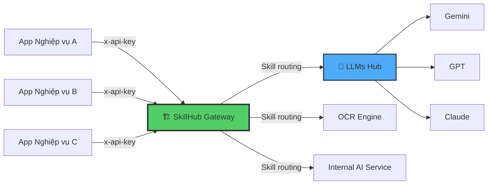

### 2.3 Project Timeline

| Giai đoạn | Hạng mục công việc chính | Sản phẩm đầu ra | Timeline |
|-----------|-------------------------|-----------------|----------|
| Phase 1 | MVP — Document Understanding Skill Group (6 Skills) + Admin UI | SkillHub v1.0, Admin Dashboard | Q2-2026 |
| Phase 2 | Production hardening, HA/DR, Monitoring, Skill Registry API | Production-ready deployment on K8s | Q3-2026 |
| Phase 3 | Multi-team onboarding, thêm Skill Group mới, Cost tracking | Full enterprise rollout | Q4-2026 |

### 2.4 Architecture Principles

| # | Nguyên tắc | Mô tả |
|---|-----------|------|
| AP-1 | **Gateway Abstraction** | Ứng dụng nghiệp vụ KHÔNG bao giờ gọi trực tiếp AI backend. SkillHub là điểm truy cập duy nhất. |
| AP-2 | **Unified Parameter Guardrails** | Mọi tùy chỉnh tham số phụ thuộc vào khai báo `ParamSchema` tập trung. Các tham số hệ thống bị khóa sẽ bị từ chối nếu Client gửi từ bên ngoài. |
| AP-3 | **Profile-Driven Isolation** | Cấu hình Profile chỉ định các tham số và logic routing riêng cho từng API Key mà không ảnh hưởng key khác. |
| AP-4 | **Async-First** | Mọi pipeline mặc định bất đồng bộ (`202 Accepted`). |
| AP-5 | **Zero Client Code Change** | Thay đổi AI backend, pipeline model chỉ cần admin thao tác trên Server — 0 dòng code ứng dụng thay đổi. |
| AP-6 | **Defence in Depth** | Tầng auth kép: NextAuth (Admin UI) + API Key (Public API). AES-256-GCM bảo vệ secret key lưu trữ. |
| AP-7 | **Extensible by Design** | Skill Group mới được thêm vào SKILL_REGISTRY mà không cần thay đổi core engine hay deployment. |

---

## 3. Requirements

### 3.1 Functional Requirement

#### 3.1.1 Skill Registry & Skill Group

SkillHub tổ chức AI capability theo mô hình **Skill Group → Skill → Sub-case**:

```
SkillHub
├── Skill Group: Document Understanding     ← /api/v1/doc/*
│   ├── Skill: ingest                       ← /api/v1/doc/ingest
│   │   ├── Sub-case: parse
│   │   ├── Sub-case: ocr
│   │   ├── Sub-case: digitize
│   │   └── Sub-case: split
│   ├── Skill: extract                      ← /api/v1/doc/extract
│   ├── Skill: analyze                      ← /api/v1/doc/analyze
│   ├── Skill: transform                    ← /api/v1/doc/transform
│   ├── Skill: generate                     ← /api/v1/doc/generate
│   └── Skill: compare                      ← /api/v1/doc/compare
├── Skill Group: Data Analytics (planned)   ← /api/v1/data/*
├── Skill Group: Customer Intel (planned)   ← /api/v1/customer/*
└── ...
```

#### 3.1.2 Document Understanding — 6 Skills (Phase 1)

| # | Skill | Endpoint | Chức năng | Sub-cases |
|---|-------|----------|-----------|-----------|
| 1 | ingest | `/api/v1/doc/ingest` | Đọc, OCR, số hóa tài liệu | `parse`, `ocr`, `digitize`, `split` |
| 2 | extract | `/api/v1/doc/extract` | Trích xuất dữ liệu có cấu trúc | `invoice`, `contract`, `id-card`, `receipt`, `table`, `custom` |
| 3 | analyze | `/api/v1/doc/analyze` | Đánh giá, phân loại, fact-check | `classify`, `sentiment`, `compliance`, `fact-check`, `quality`, `risk`, `summarize-eval` |
| 4 | transform | `/api/v1/doc/transform` | Chuyển đổi, dịch thuật, mã hóa PII | `convert`, `translate`, `rewrite`, `redact`, `template` |
| 5 | generate | `/api/v1/doc/generate` | Sinh nội dung mới (tóm tắt, QA) | `summary`, `qa`, `outline`, `report`, `email`, `minutes` |
| 6 | compare | `/api/v1/doc/compare` | So sánh ngữ nghĩa/text diff | `diff`, `semantic`, `version` |

#### 3.1.3 Core Architecture Pattern

```
Client Request → Middleware (Auth) → Skill Router (Routing & Param Guard) → Pipeline Submit → Pipeline Engine → External API Processor → LLMs Hub / AI Backend
       ↑                                                                                                                                           ↓
       └──────────────────── Operation Polling / Webhook ←─────────────────── PostgreSQL (State Machine) ←─────────────────────────────────────────┘
```

### 3.2 Non-Functional Requirement

| # | Non-Functional Requirement | Description |
|---|---------------------------|-------------|
| 1 | **Business Volume** | Expected business volume in 3 years |

|   | | 1st Year | 2nd Year | 3rd Year |
|---|---|----------|----------|----------|
|   | Số đơn vị nghiệp vụ tích hợp | 3-5 | 8-12 | 15-20 |
|   | Số Skill Group active | 1 (Doc Understanding) | 2-3 | 4-5 |
|   | Concurrent API requests | 50 | 100 | 200 |
|   | Số lượng operations/ngày | 5,000 | 15,000 | 30,000 |
| 2 | **Performance Requirements** | |
|   | API Gateway latency (P95) | < 500ms (gateway overhead, không tính AI processing) |
|   | Pipeline submission | < 1s |
|   | Admin UI page load | < 3s |
|   | Operation polling response | < 200ms |
| 3 | **Risk Tolerance** | |
|   | | RTO | RPO |
|   | Non-disaster event | 15 min | 1h |
|   | Disaster event | 4h | 24h |
| 4 | **Data Volume** | |
|   | Max upload file size | 300MB |
|   | Concurrent uploads | 50 |
|   | Average file size | 2-5MB (PDF/DOCX) |
| 5 | **Backup Data & Schedule** | |
|   | What? | DB (PostgreSQL) + Uploaded files |
|   | Schedule | Daily incremental, Weekly full |
| 6 | **Data Retention** | |
|   | Retained Online: | |
|   | + Uploaded files | 24 hours |
|   | + Operation metadata | 30 days |
|   | Archived: | |
|   | + Operation metadata | 1 year |
|   | Disposal: After archive period |
| 7 | **Data Available** | T-1 |
| 8 | **SLA** | |
|   | API Gateway | 99.9% uptime |
|   | Admin UI | 99.5% uptime |
| 9 | **Security Requirement** | Xem mục [4.8 Security](#48-security) |

---

## 4. Architecture

### 4.1 Logical

SkillHub hoạt động như một **AI Skill Registry & Gateway** tập trung, nằm giữa các ứng dụng nghiệp vụ nội bộ và các AI backend (LLMs Hub, OCR Engine, Internal AI Service). Kiến trúc logic bao gồm:

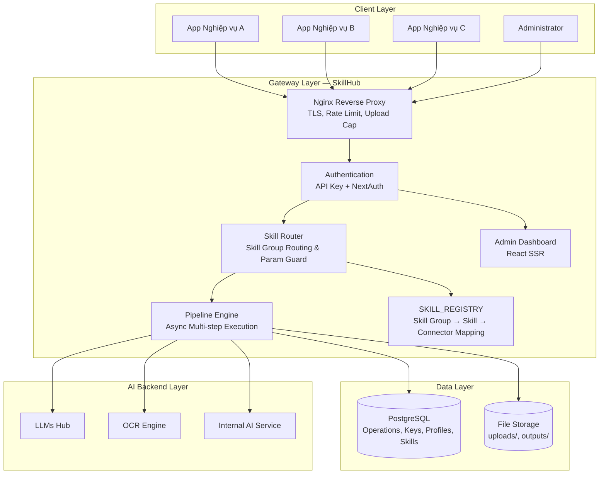

### 4.2 Application — C4 Model

#### 4.2.1 C4 Level 1 — System Context Diagram

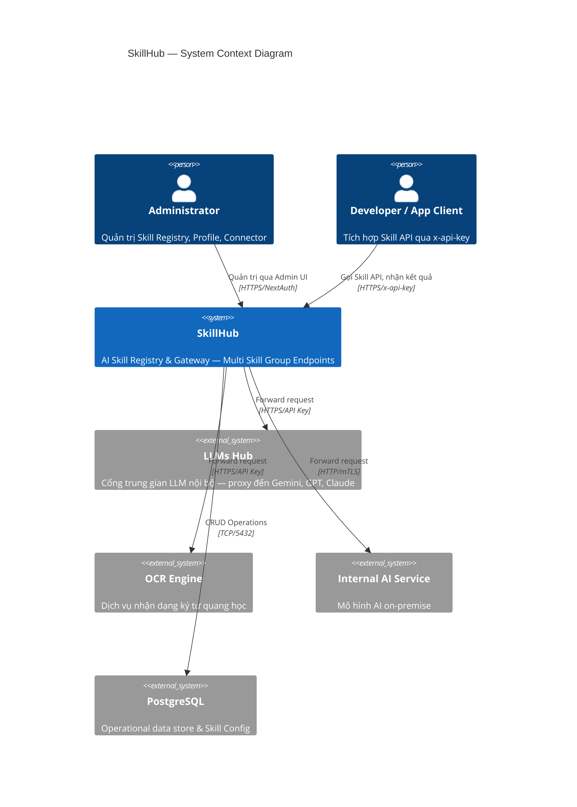

#### 4.2.2 C4 Level 2 — Container Diagram

##### System Description

| # | Group | System / Sub-System | Description |
|---|-------|-------------------|-------------|
| 1 | Gateway | Nginx Reverse Proxy | TLS termination, rate limiting, upload size cap (300MB), X-Forwarded headers. Image: `nginx:alpine` |
| 2 | Gateway | Next.js Application | Skill routing, auth middleware, pipeline engine, admin UI, webhook dispatcher. Image: `node:20-slim` (multi-stage) |
| 3 | Data | PostgreSQL | Operation state machine, API Key store, connection registry, skill profile config. Image: `postgres:16-alpine` |
| 4 | Data | Persistent Volumes | Docker Volumes cho uploads/, outputs/, pgdata/ |
| 5 | External | LLMs Hub | Cổng trung gian LLM nội bộ — proxy đến Gemini, GPT, Claude |
| 6 | External | OCR Engine | Dịch vụ nhận dạng ký tự quang học |
| 7 | External | Internal AI Service | Mô hình AI on-premise |

##### Container Diagram

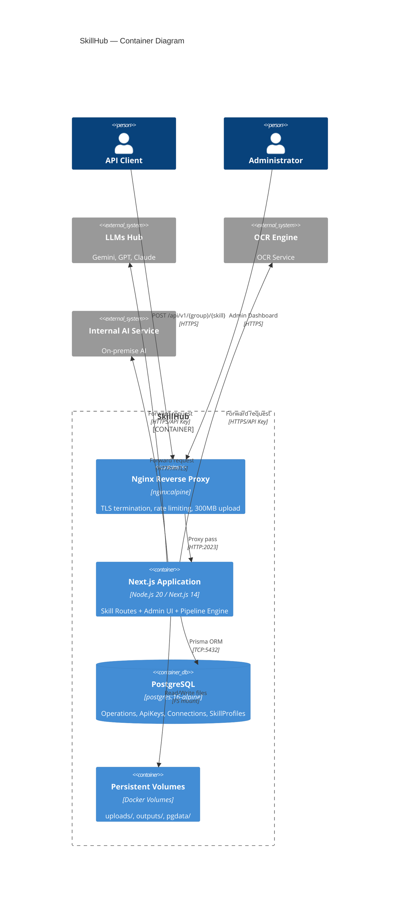

#### 4.2.3 C4 Level 3 — Component Diagram

##### Component Inventory

| # | Component Group | Component Name | Container Type | Description |
|---|----------------|---------------|---------------|-------------|
| 1 | Middleware | middleware.ts | Service | Dual Auth Gate — xác thực API Key (public) hoặc NextAuth JWT (admin) |
| 2 | API Routes | /api/v1/{group}/{skill} | Service | Skill endpoints — hiện tại: `/api/v1/doc/{skill}` cho Document Understanding |
| 3 | API Routes | /api/operations, /api/settings, /api/users | Service | Admin CRUD routes |
| 4 | API Routes | /api/internal/auth-key | Service | Internal key validation — chỉ middleware gọi được |
| 5 | API Routes | /api/health | Service | Healthcheck endpoint (public) |
| 6 | Core Engine | SKILL_REGISTRY | Configuration | Skill Group → Skill → Sub-case mapping, Unified ParamSchema Metadata, Connector mappings |
| 7 | Core Engine | Skill Router | Service | Skill Group discriminator routing, Unified Param Guard & Merge, Profile resolution |
| 8 | Core Engine | Pipeline Submit | Service | Validation, file save, Operation create, idempotency check |
| 9 | Core Engine | Pipeline Engine | Service | Sequential step execution, retry, progress tracking |
| 10 | Core Engine | External API Processor | Service | multipart/form-data builder, cURL logging, prompt interpolation, dot-path parser |
| 11 | Shared Libraries | Auth Module | Library | NextAuth — chỉ OIDC (SSO) |
| 12 | Shared Libraries | Prisma Client | Library | Type-safe ORM |
| 13 | Shared Libraries | Crypto Module | Library | AES-256-GCM encryption/decryption |
| 14 | Shared Libraries | Logger | Library | Structured JSON logs with correlation ID |
| 15 | Shared Libraries | Upload Helper | Library | File I/O operations |
| 16 | Shared Libraries | Parser Factory | Library | PDF/DOCX native parse (skip external call → cost = $0) |
| 17 | Admin UI | Home Page | Web Application | Skill Group overview & navigation |
| 18 | Admin UI | Operations Dashboard | Web Application | Operation monitoring & management |
| 19 | Admin UI | Profile Manager | Web Application | Per-API-Key skill endpoint configuration |
| 20 | Admin UI | API Connections Manager | Web Application | External connector CRUD |
| 21 | Admin UI | Skill Registry Browser | Web Application | Browse & manage registered Skill Groups, Skills, Sub-cases |

##### Component Diagram

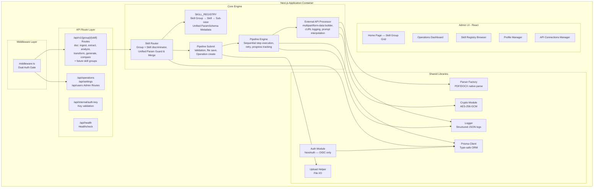

##### SKILL_REGISTRY — Document Understanding Connector Mapping

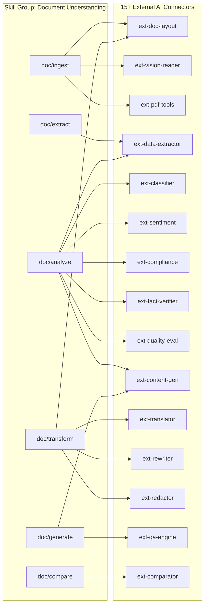

#### 4.2.4 Sequence Diagrams

##### 4.2.4.1 Luồng xử lý Skill Request (Async — Production Flow)

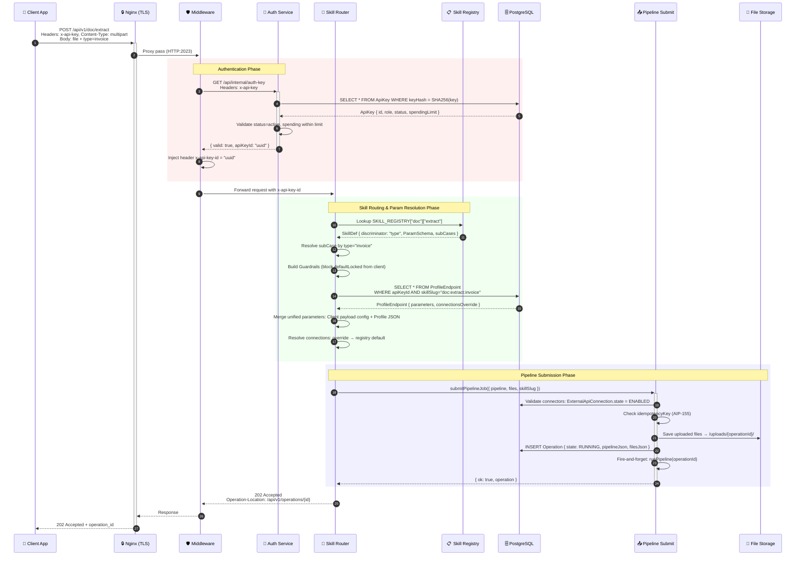

##### 4.2.4.2 Pipeline Engine — Multi-Step Execution

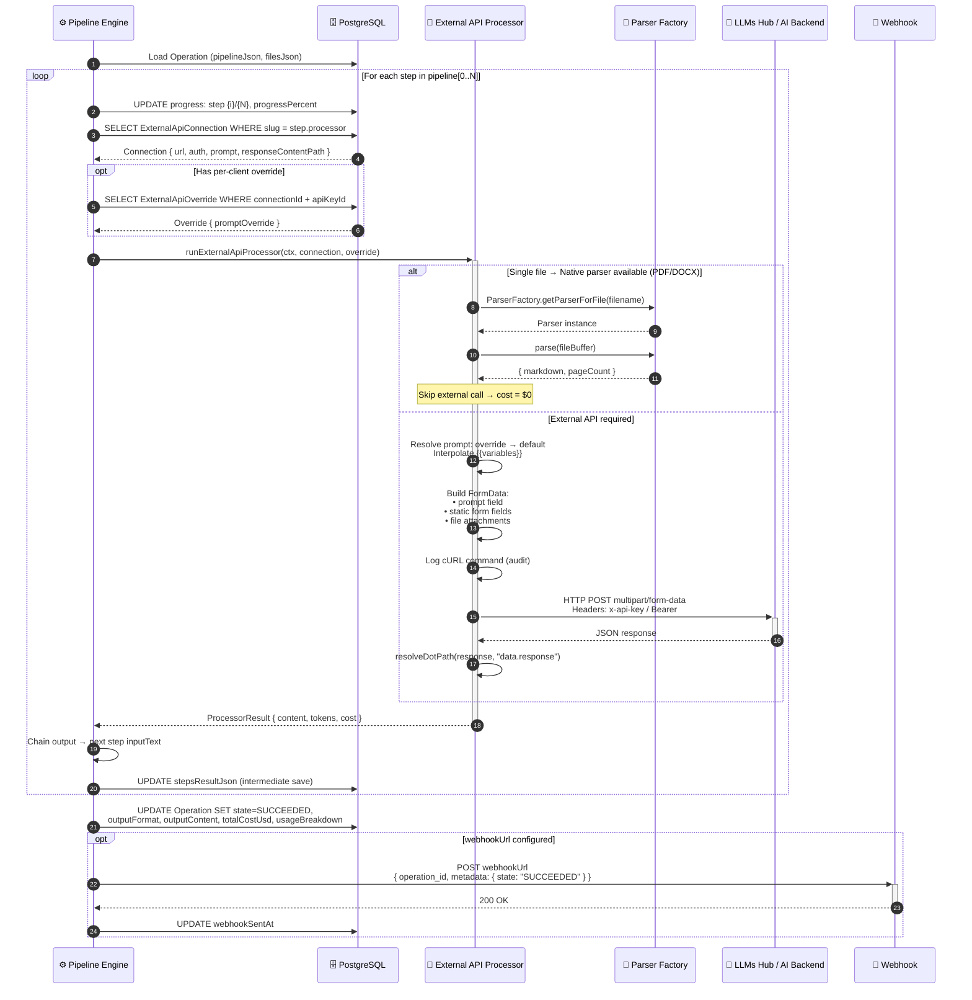

##### 4.2.4.3 Operation Polling — Client-side

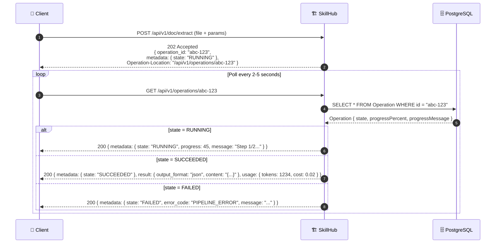

##### 4.2.4.4 Per-Profile Connector Routing Override

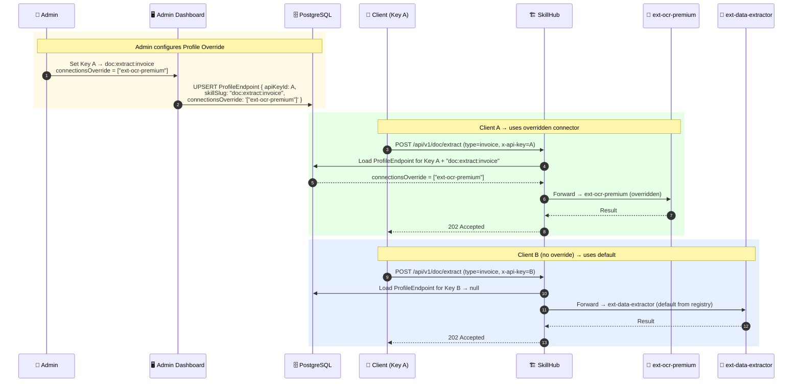

##### 4.2.4.5 Admin Authentication — NextAuth Session Flow

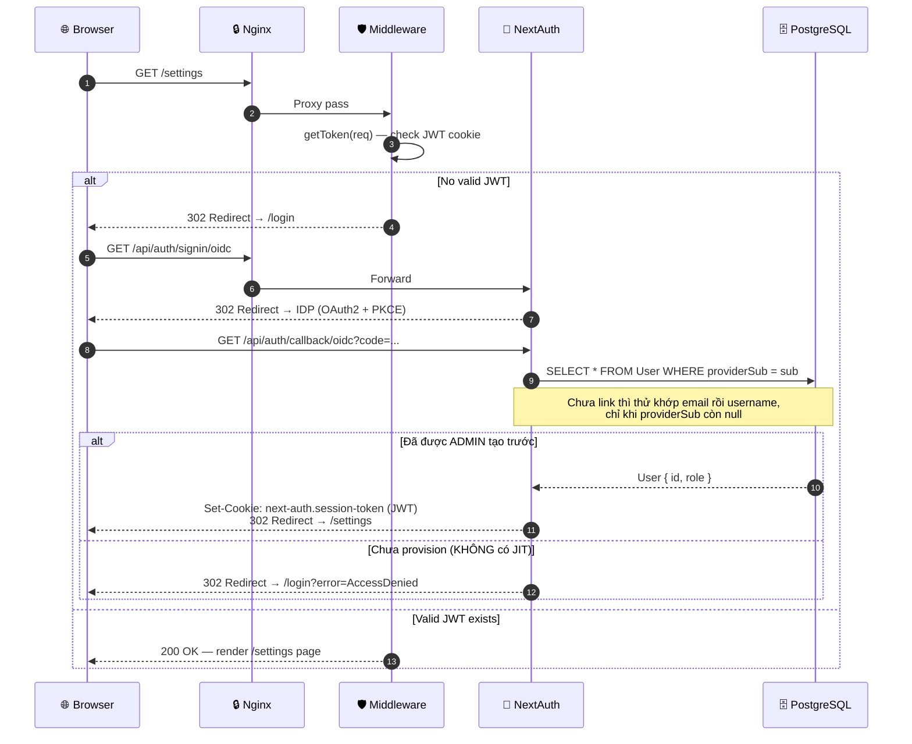

### 4.3 Integration Architecture

SkillHub tích hợp với các hệ thống bên ngoài thông qua các kênh sau:

#### 4.3.1 Integration Points

| # | Source | Target | Protocol | Direction | Description |
|---|--------|--------|----------|-----------|-------------|
| 1 | App Nghiệp vụ | SkillHub (Nginx) | HTTPS REST | Inbound | Client gọi Skill API qua `/api/v1/{group}/{skill}`, xác thực bằng `x-api-key` |
| 2 | SkillHub | LLMs Hub | HTTPS REST | Outbound | Forward request multipart/form-data tới LLMs Hub nội bộ (Gemini, GPT, Claude) |
| 3 | SkillHub | OCR Engine | HTTPS REST | Outbound | Forward request tới dịch vụ OCR |
| 4 | SkillHub | Internal AI Service | HTTP/mTLS | Outbound | Forward request tới mô hình AI on-premise |
| 5 | SkillHub | PostgreSQL | TCP/5432 | Internal | Prisma ORM — CRUD operations, state machine |
| 6 | SkillHub | Webhook Endpoint | HTTPS POST | Outbound | Callback khi pipeline hoàn thành (optional per-operation) |
| 7 | Admin Browser | SkillHub (Nginx) | HTTPS | Inbound | Admin Dashboard — NextAuth JWT session |

#### 4.3.2 Integration Flow

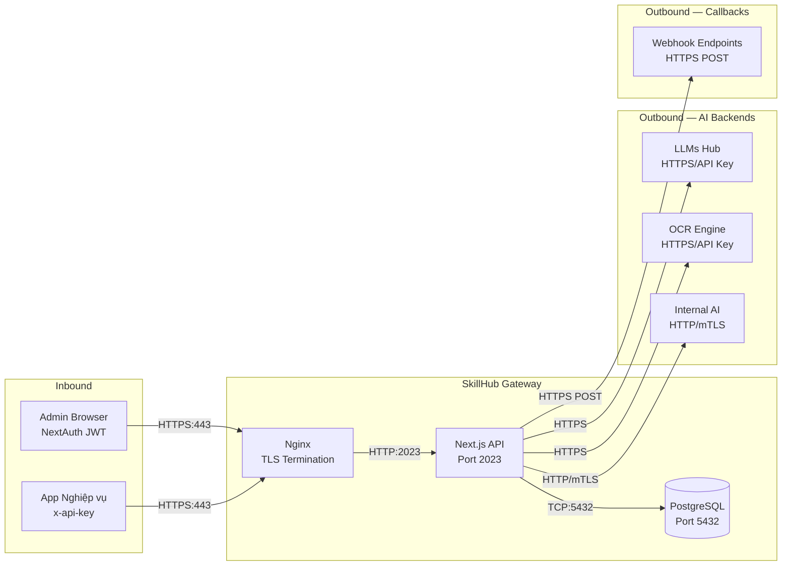

#### 4.3.3 Design Considerations

| Consideration | Decision |
|--------------|----------|
| **API Format** | RESTful multipart/form-data — tương thích LLMs Hub nội bộ, không phụ thuộc SDK |
| **URL Pattern** | `/api/v1/{group}/{skill}` — extensible cho nhiều Skill Group |
| **Authentication** | API Key (SHA-256 hash) cho M2M, NextAuth JWT cho Admin UI |
| **Retry Policy** | Per-connector `timeoutSec` + AbortController. Không retry tự động ở gateway level (tránh duplicate AI calls) |
| **Idempotency** | Client gửi `idempotencyKey` — SkillHub check trùng trước khi tạo Operation mới |
| **Data Format** | Request: multipart/form-data (file + JSON params). Response: JSON (operation state + output content) |
| **Error Handling** | Pipeline errors được capture vào Operation state (FAILED) với error code + message chi tiết |
| **Skill Extensibility** | Thêm Skill Group mới chỉ cần đăng ký vào SKILL_REGISTRY + tạo connector mapping |

### 4.4 Deployment Architecture

#### 4.4.1 Tổng quan triển khai

Hệ thống được đóng gói hoàn toàn bằng **Docker** với multi-stage build (giảm image từ ~1.2GB → ~350MB), triển khai trên **Kubernetes** cho môi trường production. Môi trường dev/staging sử dụng Docker Compose.

#### 4.4.2 Infrastructure Inventory

| # | Thành phần | Image | Port | Vai trò |
|---|-----------|-------|------|---------|
| 1 | **skillhub-app** | `node:20-slim` (multi-stage) | 2023 | Skill Gateway + Admin UI + Pipeline Engine |
| 2 | **skillhub-db** | `postgres:16-alpine` | 5432 | Operation state, API Key, Connection registry, Skill config |
| 3 | **nginx-ingress** | `nginx:alpine` | 80/443 | TLS termination, rate-limit, upload cap 300MB |

#### 4.4.3 Docker Compose — Development / Staging

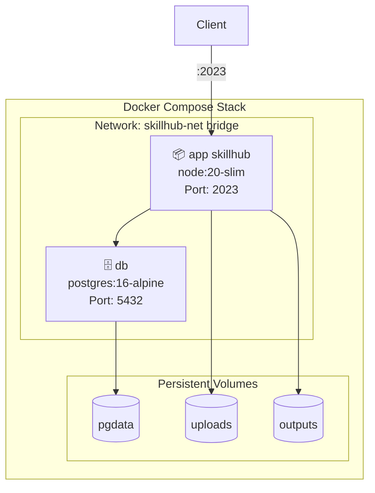

#### 4.4.4 Kubernetes — Production Topology

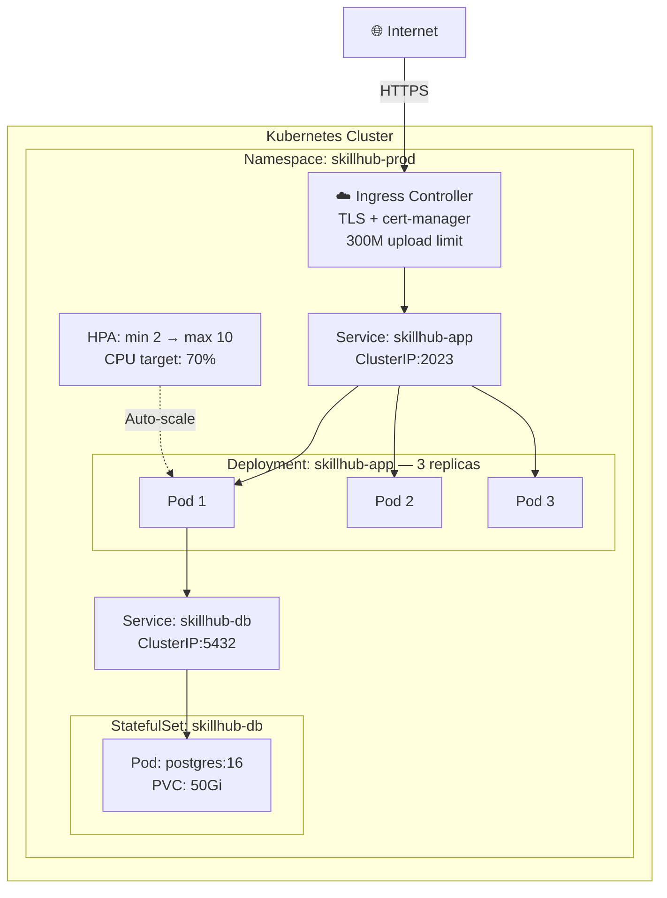

#### 4.4.5 Deployment Configuration

| Khía cạnh | Cấu hình |
|-----------|----------|
| **Deployment strategy** | RollingUpdate — `maxSurge: 1`, `maxUnavailable: 0` (zero-downtime) |
| **Auto-scaling** | HPA: 2 → 10 pods, trigger tại CPU 70% hoặc Memory 80% |
| **Health check** | Liveness + Readiness probe qua `GET /api/health` |
| **Secrets** | K8s Secret: `DB_PASSWORD`, `NEXTAUTH_SECRET`, `ENCRYPTION_KEY` |
| **Storage** | PVC ReadWriteMany cho `uploads/` và `outputs/` |
| **Database** | StatefulSet + PVC 50Gi ReadWriteOnce |
| **Resource Limits** | App pod: 512Mi-1Gi RAM, 250m-500m CPU. DB pod: 1Gi-2Gi RAM, 500m-1000m CPU |

### 4.5 Network Architecture

#### 4.5.1 Network Topology

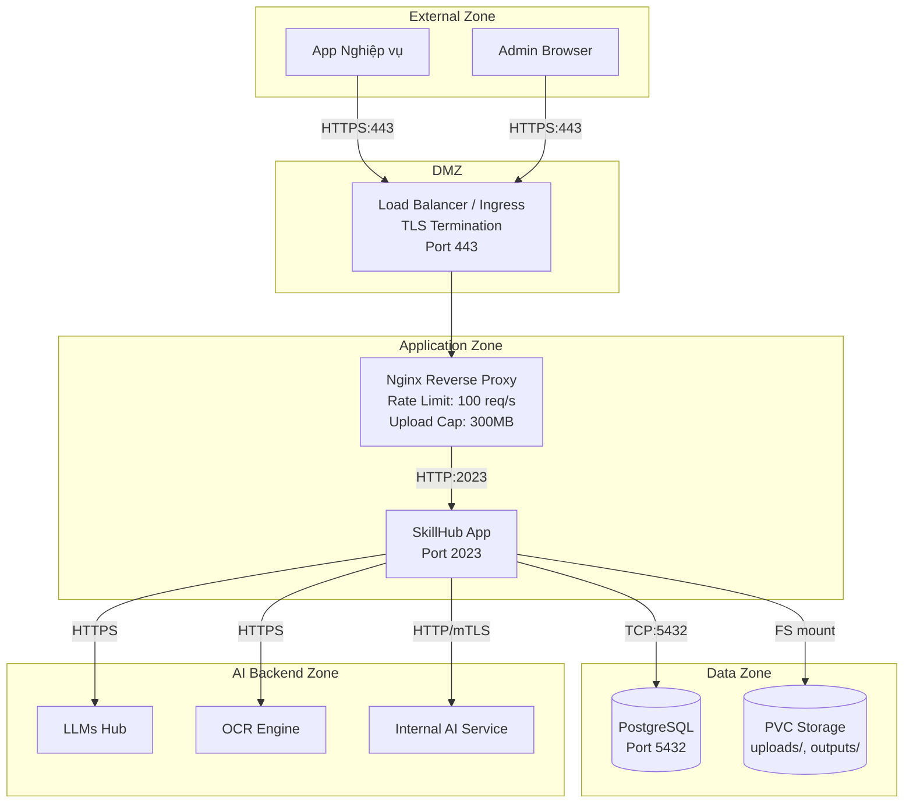

#### 4.5.2 Network Policies

| Rule | Source | Destination | Port | Protocol | Action |
|------|--------|-------------|------|----------|--------|
| Ingress → Nginx | External (LB) | Nginx | 443 | HTTPS | Allow |
| Nginx → App | Nginx | SkillHub App | 2023 | HTTP | Allow |
| App → DB | SkillHub App | PostgreSQL | 5432 | TCP | Allow |
| App → AI Backends | SkillHub App | LLMs Hub, OCR, Internal AI | 443 | HTTPS/mTLS | Allow |
| App → Webhook | SkillHub App | Webhook endpoints | 443 | HTTPS | Allow |
| Default | Any | Any | Any | Any | Deny |

#### 4.5.3 Firewall & Security Groups

| Security Group | Inbound | Outbound |
|---------------|---------|----------|
| **sg-ingress** | 443 from 0.0.0.0/0 (hoặc VPN CIDR) | All to sg-app |
| **sg-app** | 2023 from sg-ingress | 5432 to sg-db, 443 to AI backends |
| **sg-db** | 5432 from sg-app | None |

### 4.6 Logging & Monitoring

#### 4.6.1 Logging Architecture

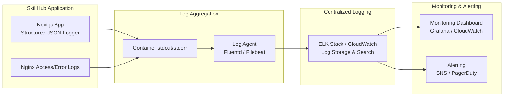

#### 4.6.2 Log Format & Fields

Mọi log entry đều ở dạng **Structured JSON** với các trường chuẩn:

| Field | Description | Example |
|-------|-------------|---------|
| `timestamp` | ISO 8601 | `2026-04-09T10:30:00.000Z` |
| `level` | Log level | `info`, `warn`, `error` |
| `correlationId` | Request correlation ID | `op-abc-123` |
| `service` | Service name | `skillhub-app` |
| `skillGroup` | Skill Group name | `doc` |
| `skill` | Skill name | `extract` |
| `endpoint` | API endpoint | `/api/v1/doc/extract` |
| `apiKeyId` | Hashed API Key ID | `uuid` |
| `action` | Action type | `pipeline.step.start`, `external.api.call` |
| `duration_ms` | Execution time | `1234` |
| `tokens` | Token usage (AI calls) | `{ prompt: 500, completion: 200 }` |
| `cost_usd` | Cost per call | `0.02` |
| `curl_command` | Reconstructed cURL (audit) | `curl -X POST ...` |

#### 4.6.3 Monitoring Metrics

| Metric | Type | Alert Threshold |
|--------|------|----------------|
| API Gateway latency (P95) | Histogram | > 500ms |
| Pipeline execution time | Histogram | > 300s per step |
| Error rate (5xx) | Counter | > 1% in 5min window |
| Active operations (RUNNING) | Gauge | > 100 concurrent |
| PostgreSQL connections | Gauge | > 80% pool |
| Disk usage (uploads/) | Gauge | > 80% capacity |
| Token usage per API Key | Counter | Per spending limit |
| Token usage per Skill Group | Counter | Dashboard tracking |
| Pod CPU/Memory | Gauge | CPU > 70%, Memory > 80% |

#### 4.6.4 Audit Trail

Mọi request tới AI backend đều được ghi lại dưới dạng **cURL command** có thể tái tạo (reproducible), bao gồm:
- Full HTTP method, URL, headers
- Form fields & file attachments (file name only, không log nội dung)
- Correlation ID liên kết với Operation ID
- Skill Group + Skill name cho phân loại
- Response status code, latency, token usage

### 4.7 HA / DC-DR

#### 4.7.1 High Availability Architecture

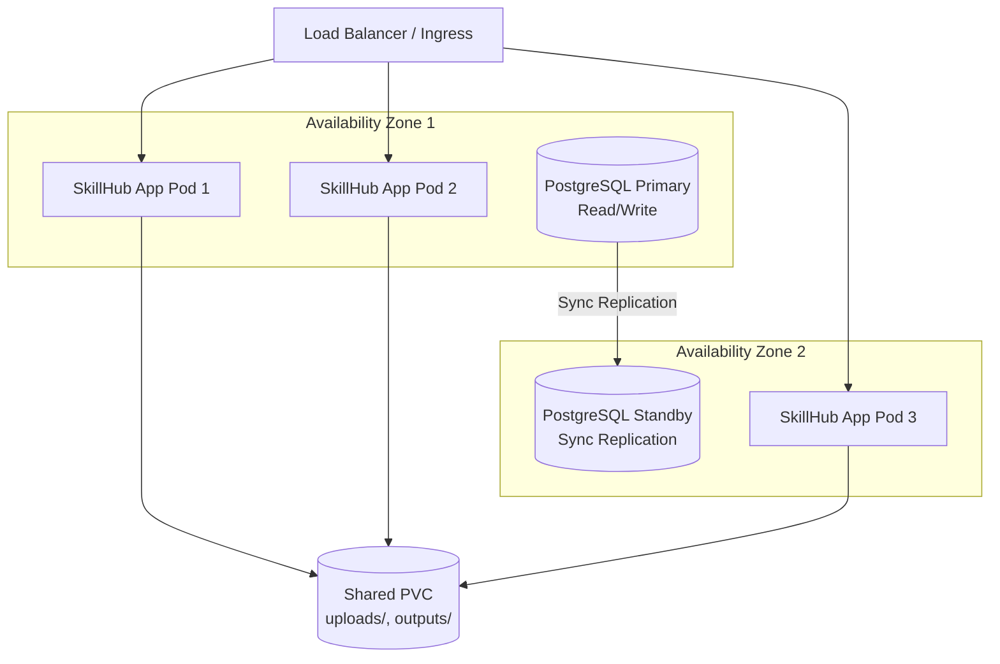

#### 4.7.2 HA Settings

| Component | HA Strategy | Details |
|-----------|------------|---------|
| **SkillHub App** | Multi-replica across AZs | K8s Deployment: min 2 replicas, spread across 2 AZs. RollingUpdate zero-downtime. |
| **PostgreSQL** | Primary-Standby (Sync) | Synchronous replication across 2 AZs. Automatic failover. |
| **File Storage** | Shared PVC (ReadWriteMany) | PVC accessible from all app pods across AZs |
| **Ingress** | Multi-AZ Load Balancer | Distributes traffic across healthy pods |

#### 4.7.3 Disaster Recovery

| Scenario | RTO | RPO | Recovery Action |
|----------|-----|-----|----------------|
| **Single pod failure** | < 30s | 0 | K8s auto-restart, LB routes to healthy pods |
| **AZ failure** | < 2min | 0 | Pods in other AZ continue serving. DB failover to standby. |
| **Database failure** | < 2min | 0 (sync replication) | Automatic failover to standby. New standby provisioned. |
| **Full cluster failure** | 15min | 1h | Restore from PG WAL archive + PVC snapshots. Rollout from container registry. |
| **Disaster (DC-level)** | 4h | 24h | Restore to DR site from daily backup. DNS failover. |

#### 4.7.4 Backup Strategy

| Data | Backup Method | Schedule | Retention |
|------|--------------|----------|-----------|
| PostgreSQL | WAL archival + pg_dump | Continuous WAL, Daily full dump | 30 days |
| PVC (uploads/outputs) | Volume snapshots | Daily | 7 days |
| K8s configs & secrets | GitOps (sealed secrets) | On change | Unlimited (Git history) |
| Container images | Container registry | On build | 90 days |

### 4.8 Security

#### 4.8.1 Authentication Matrix

| Endpoint Pattern | Auth Method | Token / Key | Session Type |
|-----------------|-------------|-------------|--------------|
| `/api/v1/{group}/*` | API Key Header | `x-api-key` → SHA-256 → DB lookup | Stateless |
| `/api/auth/*` | NextAuth OIDC (SSO) | OAuth2 + PKCE tới IDP tổ chức; pre-provisioning, không JIT | JWT cookie |
| `/api/internal/*` | Internal only (middleware bypass) | N/A — only callable by middleware | N/A |
| `/api/health` | None (public) | N/A | N/A |
| `/*` (pages) | NextAuth JWT | Session cookie | JWT |

#### 4.8.2 Secrets Management

| Secret | Storage | Rotation Strategy |
|--------|---------|-------------------|
| `DB_PASSWORD` | K8s Secret / `.env` | Quarterly, zero-downtime via pg_hba reload |
| `NEXTAUTH_SECRET` | K8s Secret | Requires re-login for all admin sessions |
| `ENCRYPTION_KEY` | K8s Secret | Requires re-encrypt all ExternalApiConnection.authSecret |
| AI API Keys | DB (AES-256-GCM encrypted) | Admin changes via Dashboard — no deployment needed |
| `x-api-key` (client) | Client-managed | Admin revokes + issues new key via Dashboard |

#### 4.8.3 Security Controls

| Control | Implementation |
|---------|---------------|
| **TLS** | Nginx TLS termination (TLS 1.2+), cert-manager auto-renewal |
| **Rate Limiting** | Nginx: 100 req/s per IP. Per-API-Key spending limit in DB. |
| **Input Validation** | File type whitelist, max upload 300MB, param schema validation per Skill |
| **Encryption at Rest** | AES-256-GCM cho AI API keys trong DB. K8s secrets encrypted at rest. |
| **Encryption in Transit** | HTTPS cho tất cả external communication. mTLS cho Internal AI Service. |
| **Network Isolation** | K8s NetworkPolicy: deny-all default, whitelist per-service. |
| **Audit Logging** | cURL reconstruction, correlation ID, skill group tracking, token usage tracking |

---

## 5. Sizing

### 5.1 Business Sizing

| Metric | Year 1 | Year 2 | Year 3 |
|--------|--------|--------|--------|
| Số đơn vị nghiệp vụ tích hợp | 3-5 | 8-12 | 15-20 |
| Số Skill Group active | 1 | 2-3 | 4-5 |
| Số lượng API Keys | 5-10 | 15-25 | 30-50 |
| Operations/ngày | 5,000 | 15,000 | 30,000 |
| Concurrent API requests | 50 | 100 | 200 |
| Avg file size | 2-5 MB | 2-5 MB | 2-5 MB |
| Storage/ngày (uploads, tạm 24h) | ~25 GB | ~75 GB | ~150 GB |
| Token usage/tháng (estimated) | 10M tokens | 30M tokens | 60M tokens |

### 5.2 Technical Sizing

#### 5.2.1 Compute Resources

| Component | Year 1 | Year 2 | Year 3 |
|-----------|--------|--------|--------|
| **SkillHub App pods** | 2-3 pods (512Mi RAM, 250m CPU each) | 3-5 pods (1Gi RAM, 500m CPU each) | 5-10 pods (1Gi RAM, 500m CPU each) |
| **PostgreSQL** | 1 primary + 1 standby (2Gi RAM, 1 CPU, 50Gi disk) | 1 primary + 1 standby (4Gi RAM, 2 CPU, 100Gi disk) | 1 primary + 1 standby (8Gi RAM, 4 CPU, 200Gi disk) |
| **Nginx Ingress** | 1-2 replicas | 2 replicas | 2-3 replicas |

#### 5.2.2 Storage Resources

| Storage Type | Year 1 | Year 2 | Year 3 |
|-------------|--------|--------|--------|
| **PVC uploads/** (ephemeral, 24h retention) | 50 Gi | 100 Gi | 200 Gi |
| **PVC outputs/** | 20 Gi | 50 Gi | 100 Gi |
| **PostgreSQL PVC** | 50 Gi | 100 Gi | 200 Gi |
| **Backup storage** | 100 Gi | 250 Gi | 500 Gi |

---

## 6. Cost Estimation

> Pricing tham khảo theo AWS On-Demand (region: us-east-1) và Google Gemini API (pay-as-you-go) tại thời điểm Q2-2026. Chi phí thực tế có thể thay đổi tùy region, Reserved Instance/Savings Plan, và thỏa thuận enterprise.
>
> Nguồn: [AWS EC2 Pricing](https://aws.amazon.com/ec2/pricing/on-demand/), [AWS RDS Pricing](https://aws.amazon.com/rds/postgresql/pricing/), [AWS ELB Pricing](https://aws.amazon.com/elasticloadbalancing/pricing/), [Google Gemini API Pricing](https://ai.google.dev/pricing)

### 6.1 Giả định tính toán

| Tham số | Year 1 | Year 2 | Year 3 |
|---------|--------|--------|--------|
| Operations/ngày | 5,000 | 15,000 | 30,000 |
| Avg tokens/operation (input + output) | ~2,000 | ~2,000 | ~2,000 |
| Token usage/tháng | ~10M | ~30M | ~60M |
| Tỷ lệ dùng Gemini 2.5 Flash | 80% | 75% | 70% |
| Tỷ lệ dùng Gemini 2.5 Pro | 20% | 25% | 30% |
| Avg input:output token ratio | 70:30 | 70:30 | 70:30 |
| EKS Worker Nodes | 2 × m5.xlarge | 3 × m5.xlarge | 5 × m5.xlarge |
| RDS PostgreSQL | db.r6g.large Multi-AZ | db.r6g.large Multi-AZ | db.r6g.xlarge Multi-AZ |

### 6.2 AWS Infrastructure Cost (Monthly Estimate)

| Component | Specification | Year 1 | Year 2 | Year 3 |
|-----------|--------------|--------|--------|--------|
| **EKS Cluster** | 1 cluster × $0.10/hr | $73 | $73 | $73 |
| **EKS Worker Nodes** | m5.xlarge (4 vCPU, 16Gi) × $0.192/hr | $280 (2 nodes) | $420 (3 nodes) | $700 (5 nodes) |
| **RDS PostgreSQL** | db.r6g.large Multi-AZ (2 vCPU, 16Gi) × ~$0.45/hr | $328 | $328 | $656 (xlarge) |
| **RDS Storage** | gp3 SSD × $0.08/GB/mo | $4 (50Gi) | $8 (100Gi) | $16 (200Gi) |
| **EBS (PVC uploads/outputs)** | gp3 SSD × $0.08/GB/mo | $6 (70Gi) | $12 (150Gi) | $24 (300Gi) |
| **ALB (Load Balancer)** | $0.0225/hr + LCU | $22 | $30 | $45 |
| **S3 Backup** | $0.023/GB/mo | $3 (100Gi) | $6 (250Gi) | $12 (500Gi) |
| **Data Transfer (egress)** | ~$0.09/GB (to AI backends, internal) | $10 | $25 | $50 |
| **Subtotal Infra** | | **~$726** | **~$902** | **~$1,576** |

> Lưu ý: Sử dụng Reserved Instance (1-year) có thể giảm ~30-40% chi phí EC2/RDS. Savings Plan có thể giảm thêm.

### 6.3 Gemini Token Pricing Reference

| Model | Input (per 1M tokens) | Output (per 1M tokens) | Đặc điểm |
|-------|----------------------|------------------------|-----------|
| **Gemini 2.5 Flash** | $0.15 | $0.60 | Nhanh, chi phí thấp, phù hợp OCR/extract/parse đơn giản |
| **Gemini 2.5 Flash** (>200K context) | $0.30 | $1.20 | Long context surcharge |
| **Gemini 2.5 Pro** | $1.25 | $10.00 | Reasoning mạnh, phù hợp analyze/compare/generate phức tạp |
| **Gemini 2.5 Pro** (>200K context) | $2.50 | $15.00 | Long context surcharge |

> Nguồn: [Google Gemini API Pricing](https://ai.google.dev/pricing) — Content was rephrased for compliance with licensing restrictions.

### 6.4 AI/LLM Cost Calculation (Monthly Estimate)

#### Year 1: ~10M tokens/tháng

| Model | Allocation | Input Tokens | Output Tokens | Input Cost | Output Cost | Total |
|-------|-----------|-------------|--------------|------------|-------------|-------|
| **Gemini 2.5 Flash** (80%) | 8M tokens | 5.6M | 2.4M | $0.84 | $1.44 | $2.28 |
| **Gemini 2.5 Pro** (20%) | 2M tokens | 1.4M | 0.6M | $1.75 | $6.00 | $7.75 |
| **Subtotal** | 10M | | | | | **~$10** |

#### Year 2: ~30M tokens/tháng

| Model | Allocation | Input Tokens | Output Tokens | Input Cost | Output Cost | Total |
|-------|-----------|-------------|--------------|------------|-------------|-------|
| **Gemini 2.5 Flash** (75%) | 22.5M tokens | 15.75M | 6.75M | $2.36 | $4.05 | $6.41 |
| **Gemini 2.5 Pro** (25%) | 7.5M tokens | 5.25M | 2.25M | $6.56 | $22.50 | $29.06 |
| **Subtotal** | 30M | | | | | **~$35** |

#### Year 3: ~60M tokens/tháng

| Model | Allocation | Input Tokens | Output Tokens | Input Cost | Output Cost | Total |
|-------|-----------|-------------|--------------|------------|-------------|-------|
| **Gemini 2.5 Flash** (70%) | 42M tokens | 29.4M | 12.6M | $4.41 | $7.56 | $11.97 |
| **Gemini 2.5 Pro** (30%) | 18M tokens | 12.6M | 5.4M | $15.75 | $54.00 | $69.75 |
| **Subtotal** | 60M | | | | | **~$82** |

> Chi phí token Gemini rất thấp so với infrastructure. Tuy nhiên, nếu volume tăng lên 500M-1B tokens/tháng (khi nhiều Skill Group active), chi phí Pro sẽ tăng đáng kể. Nên ưu tiên Flash cho các task đơn giản và chỉ dùng Pro cho reasoning phức tạp.

### 6.5 Total Cost of Ownership (TCO)

| Category | Year 1 (Monthly) | Year 1 (Annual) | Year 2 (Monthly) | Year 2 (Annual) | Year 3 (Monthly) | Year 3 (Annual) |
|----------|-----------------|-----------------|-----------------|-----------------|-----------------|-----------------|
| AWS Infrastructure | $726 | $8,712 | $902 | $10,824 | $1,576 | $18,912 |
| Gemini AI Tokens | $10 | $120 | $35 | $420 | $82 | $984 |
| OCR Engine | $0 (via LLMs Hub) | $0 | $0 | $0 | $0 | $0 |
| Licensing | $0 (OSS) | $0 | $0 | $0 | $0 | $0 |
| **Total** | **$736** | **$8,832** | **$937** | **$11,244** | **$1,658** | **$19,896** |

| | Year 1 | Year 2 | Year 3 | 3-Year Total |
|---|--------|--------|--------|-------------|
| **Grand Total** | **$8,832** | **$11,244** | **$19,896** | **$39,972** |

#### Cost Optimization Opportunities

| Strategy | Estimated Savings | Notes |
|----------|------------------|-------|
| **Reserved Instances (1-year)** | ~30-40% on EC2/RDS | Cam kết 1 năm, giảm ~$2,600-3,500/năm |
| **Savings Plan (Compute)** | ~20-30% on EC2 | Linh hoạt hơn RI, áp dụng cross-instance |
| **Spot Instances (non-critical pods)** | ~60-70% on worker nodes | Chỉ cho stateless app pods, không cho DB |
| **Native Parser (PDF/DOCX)** | 100% token savings | Skip AI call cho parse đơn giản → $0 |
| **Flash over Pro routing** | ~90% per-token savings | Tự động route task đơn giản sang Flash |
| **Graviton instances (m7g)** | ~20% cheaper than m5 | ARM-based, tương thích Node.js |

> **Với Reserved Instance + Graviton**, chi phí 3 năm ước tính giảm còn ~$25,000-28,000 (tiết kiệm ~30%).

---

## 7. Technology Stack Decision Matrix

| Layer | Technology | Lý do chọn | Thay thế đã xem xét |
|-------|-----------|-----------|---------------------|
| **Runtime** | Node.js 20 LTS | Ecosystem Next.js, async I/O native, low-memory footprint | Deno (immature ecosystem) |
| **Framework** | Next.js 14 App Router | SSR admin UI + API routes cùng codebase, chuẩn Vercel | Express.js (không có SSR), NestJS (over-engineering) |
| **Database** | PostgreSQL 16 | ACID, JSONB native, Prisma first-class support, mature | MySQL (JSONB yếu), MongoDB (không ACID) |
| **ORM** | Prisma 5 | Type-safe schema, auto-migration, connection pooling | TypeORM (less type-safe), Drizzle (younger ecosystem) |
| **Auth** | NextAuth v4, chỉ OIDC | Native Next.js integration, JWT stateless; SSO bắt buộc theo quy định, ứng dụng không lưu credential | Passport.js (not Next-native), Clerk (SaaS dependency) |
| **Encryption** | AES-256-GCM (native crypto) | Zero-dependency, NIST approved, authenticated encryption | Vault (infrastructure overhead) |
| **Container** | Docker + multi-stage build | 350MB production image, reproducible builds | Podman (less tooling) |
| **Orchestration** | Kubernetes | HPA, rolling update, secret management, network policy | Docker Swarm (limited auto-scaling) |
| **Reverse Proxy** | Nginx | TLS termination, rate-limit, mature config | Traefik (auto-discovery overkill for single service) |
| **AI Integration** | HTTP multipart/form-data via LLMs Hub | Provider-agnostic, tương thích LLMs Hub nội bộ, no SDK lock-in | SDK per-provider (tight coupling, bypass Hub) |

---

## 8. Approval Sign-off

| Vai trò | Họ tên | Ngày | Chữ ký |
|---------|--------|------|--------|
| **Solution Architect** | | | |
| **Technical Lead** | | | |
| **Security Officer** | | | |
| **Infrastructure Lead** | | | |
| **Project Manager** | | | |

---

> **Document Control**
> - v1.0 (2026-04-09): Rebrand từ DUGate → SkillHub. Chuyển đổi mô hình từ Document Understanding Gateway sang AI Skill Registry & Gateway. Document Understanding trở thành Skill Group đầu tiên. URL pattern: `/api/v1/{group}/{skill}`. Thêm SKILL_REGISTRY, Skill Registry Browser, AP-7 Extensible by Design. Bổ sung Skill Group roadmap.
> - Next review: Q3-2026

---

*SkillHub — AI Skill Registry & Gateway cho doanh nghiệp, powered by AI Factory.*
